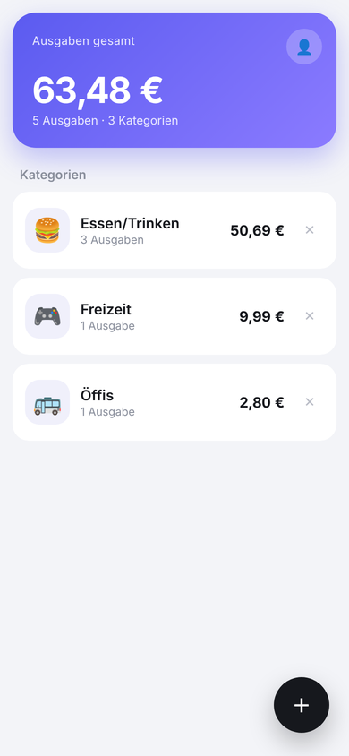
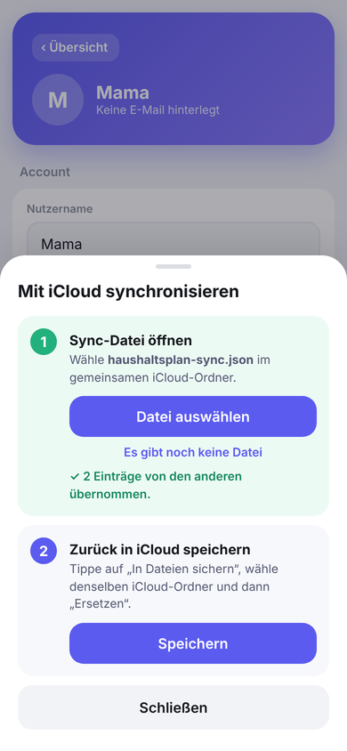

# 🧾 Haushaltsplan

Eine einfache, schnelle Web-App, in der die ganze Familie ihre Ausgaben sammelt –
übersichtlich nach Kategorien und über einen gemeinsamen **iCloud-Drive-Ordner** abgeglichen.

**👉 App öffnen: https://treneus.github.io/haushaltsplan/**

<p>
  
  
  
  
</p>

## Funktionen

- **Kategorien** wie Essen/Trinken, Freizeit, Öffis – eigene hinzufügen und löschen
  (Löschen nur nach Eintippen von „Löschen“)
- **Ausgaben** mit Betrag, Beschreibung und Datum (vorausgewählt: heute, „Gestern“ per Knopf)
- **Löschen** per Wischen nach links oder ✕ – mit „Rückgängig“
- **iCloud-Sync**: Die Familie teilt einen iCloud-Ordner mit einer Sync-Datei.
  Abgleichen in zwei Schritten: Datei öffnen → wieder speichern
- **Jedes Gerät hat alle Daten selbst** – funktioniert auch ohne Internet
- **Wie eine echte App** auf dem iPhone: „Zum Home-Bildschirm“, Vollbild, eigenes Symbol
- Kein App Store, kein Server, keine Anmeldung, keine Kosten

## Schnellstart

1. App-Link in **Safari** öffnen → **Teilen** → **„Zum Home-Bildschirm“**
2. In der **Dateien-App** unter iCloud Drive einen Ordner **„Haushaltsplan“** anlegen und mit der Familie teilen
3. In der App oben auf den **Sync-Knopf** tippen

📖 Ausführlich: **[docs/ANLEITUNG.md](docs/ANLEITUNG.md)**

## Dokumentation

| Dokument | Für wen | Inhalt |
|---|---|---|
| [docs/ANLEITUNG.md](docs/ANLEITUNG.md) | Alle | Einrichtung, iCloud-Ordner teilen, Bedienung, häufige Fragen |
| [docs/TECHNIK.md](docs/TECHNIK.md) | Entwickler | Aufbau, Datenmodell, Sync-Verfahren, Dateiformat, Sicherheit, Tests |

## Projektaufbau

```
haushaltsplan/
├── index.html            Oberfläche (alle Bildschirme und Fenster)
├── style.css             Aussehen und Animationen
├── manifest.webmanifest  App-Name und Symbol für den Home-Bildschirm
├── sw.js                 Service Worker: App startet auch offline
├── start.sh              lokal unter Linux starten
├── icons/                App-Symbole
├── js/
│   ├── store.js          Datenspeicher auf dem Gerät + Zusammenführen
│   ├── sync.js           Abgleich über die Sync-Datei in iCloud Drive
│   └── app.js            Bildschirme, Knöpfe, Listen
└── docs/                 Anleitung, Technik-Doku, Bilder
```

## Lokal entwickeln (Linux)

```bash
./start.sh        # öffnet die App unter http://localhost:8080
./start.sh 2      # zweites "Testgerät" mit eigenen Daten
```

Reines HTML, CSS und JavaScript – kein Build-Schritt, keine Abhängigkeiten.
Änderungen hochladen → GitHub Pages veröffentlicht sie automatisch.
