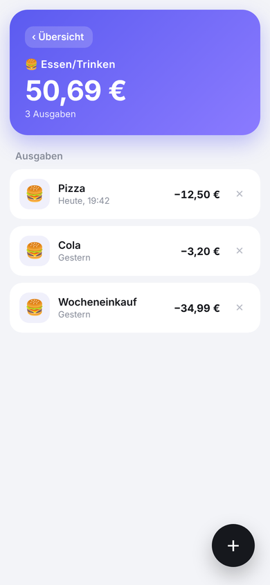
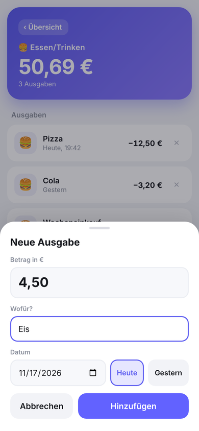

# 🧾 Haushaltsplan

Eine einfache, schnelle Web-App, in der die ganze Familie ihre Ausgaben sammelt –
übersichtlich nach Kategorien, auf allen Handys synchron und Ende-zu-Ende-verschlüsselt.

**👉 App öffnen: https://treneus.github.io/haushaltsplan/**

<p>
  
  
  
</p>

## Funktionen

- **Kategorien** wie Essen/Trinken, Freizeit, Öffis – eigene hinzufügen und löschen
  (Löschen nur nach Eintippen von „Löschen“)
- **Ausgaben** mit Betrag, Beschreibung und Datum (vorausgewählt: heute, „Gestern“ per Knopf)
- **Löschen** per Wischen nach links oder ✕ – mit „Rückgängig“
- **Haushalt**: Familie verbindet sich mit Code + Passwort, alles wird alle 3 Minuten abgeglichen
- **Verschlüsselt**: Der Server sieht nur Zeichensalat – das Passwort verlässt nie das Handy
- **Offline nutzbar**: Jedes Gerät hat alle Daten selbst, der Abgleich wird nachgeholt
- **Wie eine echte App** auf dem iPhone: „Zum Home-Bildschirm“, Vollbild, eigenes Symbol
- Kein App Store, keine Installation, keine Kosten

## Auf dem iPhone installieren

1. Link oben in **Safari** öffnen
2. Unten auf **Teilen** (□↑) tippen → **„Zum Home-Bildschirm“**
3. Ab jetzt die App über das neue Symbol starten
   *(wichtig: Daten aus Safari und vom Home-Bildschirm sind auf dem iPhone getrennt –
   immer das Symbol benutzen)*

## Einrichtung (einmalig)

Damit sich die Handys abgleichen, braucht die App ein kostenloses Supabase-Projekt.
Das dauert etwa 10 Minuten und ist Schritt für Schritt hier beschrieben:

📖 **[docs/ANLEITUNG.md](docs/ANLEITUNG.md)** – Einrichtung und Bedienung

Ohne Einrichtung funktioniert die App auch – dann nur auf dem eigenen Gerät.

## Dokumentation

| Dokument | Für wen | Inhalt |
|---|---|---|
| [docs/ANLEITUNG.md](docs/ANLEITUNG.md) | Alle | Einrichtung, Installation, Bedienung, häufige Fragen |
| [docs/TECHNIK.md](docs/TECHNIK.md) | Entwickler | Aufbau, Datenmodell, Sync, Verschlüsselung, Sicherheit, Tests |
| [supabase/setup.sql](supabase/setup.sql) | Einrichtung | Datenbank-Tabellen und Zugriffsregeln |

## Projektaufbau

```
haushaltsplan/
├── index.html            Oberfläche (alle Bildschirme und Fenster)
├── style.css             Aussehen und Animationen
├── config.js             Supabase-Adresse und -Schlüssel (einmal eintragen)
├── manifest.webmanifest  App-Name und Symbol für den Home-Bildschirm
├── sw.js                 Service Worker: App startet auch offline
├── start.sh              lokal unter Linux starten
├── icons/                App-Symbole
├── js/
│   ├── store.js          Datenspeicher auf dem Gerät + Zusammenführen
│   ├── crypto.js         Verschlüsselung mit dem Haushalts-Passwort
│   ├── cloud.js          Verbindung zu Supabase
│   ├── sync.js           automatischer Abgleich
│   └── app.js            Bildschirme, Knöpfe, Listen
├── supabase/setup.sql    Datenbank-Einrichtung
└── docs/                 Anleitung, Technik-Doku, Bilder
```

## Lokal entwickeln (Linux)

```bash
./start.sh        # öffnet die App unter http://localhost:8080
./start.sh 2      # zweites "Testgerät" mit eigenen Daten
```

Reines HTML, CSS und JavaScript – kein Build-Schritt, keine Abhängigkeiten.
Änderungen hochladen → GitHub Pages veröffentlicht sie automatisch.
